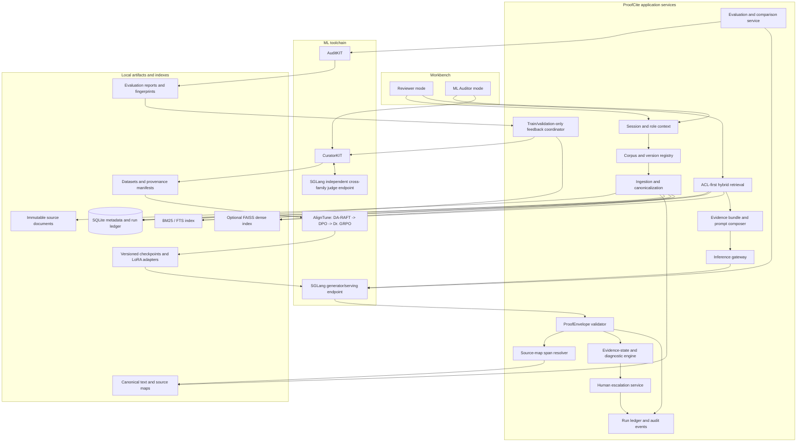
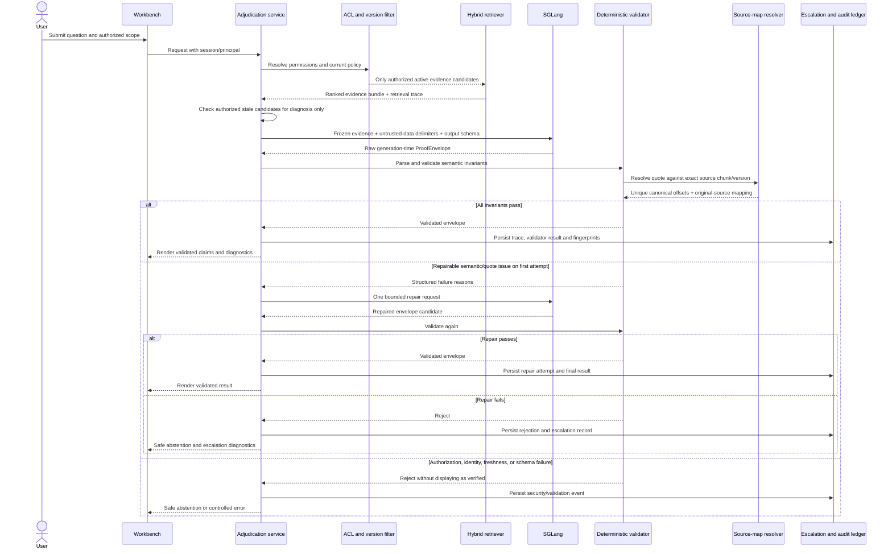

# ProofCite-Local — System Architecture

**Status:** Implementation design derived from `IDEA.md` (24 October 2026). This file describes the intended architecture; it is not evidence that the components or integrations have already been implemented or tested.

## 1. Product boundary

ProofCite-Local is a local-first document adjudication system for compliance analysts, legal contract reviewers, and operations/SRE teams. It answers questions using authorized internal documents and returns a structured `ProofEnvelope`. Each displayed factual claim must be connected to a unique, exact source span in an authorized document version. When evidence is missing, partial, stale, or conflicting, the system diagnoses the problem and abstains or escalates rather than guessing.

The selected scope remains **Syntax Error 2026 Local LLM Track — Problem Statement #3: Grounded answers and fewer hallucinations**. Synthetic data curation and JSON schema enforcement are methods supporting that scope, not separate product scopes.

### Non-negotiable constraints from `IDEA.md`

- SGLang is the core inference and serving engine; target version is `0.5.22`, subject to an explicit runtime smoke test.
- Stage 1 uses CuratorKIT; Stage 2 uses AlignTune; Stage 3 uses AuditKIT plus SGLang.
- Primary model: `Qwen/Qwen3-4B-Instruct-2507`, subject to hardware validation.
- Evidence states: `SUPPORTED`, `PARTIAL`, `MISSING`, `CONFLICTED`, `STALE`.
- Chunk triage states: `RELEVANT_ACTIVE`, `DISTRACTOR_IRRELEVANT`, `SUPERSEDED_STALE`, `RESTRICTED_ACL`, `ADVERSARIAL_IGNORED`.
- Every claim must carry source identity, version, an exact quote, computed character offsets, and a rationale. Substring containment alone is not proof of entailment.
- ACLs are enforced before retrieval and again during citation validation. Retrieved text is untrusted data. The generator has no action/execution tools.
- Exactly one bounded semantic/quote repair attempt is allowed. If validation still fails, fail closed with safe abstention/escalation.
- Dataset splits are locked before synthetic generation; test/OOD examples and test-derived failure labels never enter the self-healing training loop.
- Report pre-validator model behaviour separately from post-validator system behaviour. Performance targets are hypotheses until measured.

## 2. Architecture decisions

These are implementation choices for the first working build, not changes to the research thesis:

1. **Modular monolith first.** Keep ingestion, retrieval, validation, orchestration, and audit logic in one Python application package. Do not introduce network microservices or orchestration infrastructure for the hackathon prototype.
2. **Thin local workbench.** Keep the UI as a client of application services. The initial implementation may use Gradio Blocks for the workbench and a local PDF.js-backed source viewer; the backend rules must not live in UI callbacks.
3. **Local persistent metadata.** Use SQLite for document/version metadata, access policies, run records, escalation records, and references to artifacts. Store immutable source files, canonical text, indexes, and model/training artifacts in separate directories. Confirm SQLite FTS5 availability; if unavailable, use the configured local BM25 implementation. Use a local FAISS index only for dense retrieval when the embedding dependency is present.
4. **Replaceable infrastructure adapters.** Put SGLang, CuratorKIT, AlignTune, and AuditKIT behind thin adapters. The product services must depend on the adapters' interfaces rather than scatter toolkit-specific calls throughout the app.
5. **One source of truth for evidence.** The immutable corpus snapshot and its canonical-text/source-map records own citation identity and offsets. The model never supplies authoritative offsets; the server computes them.
6. **Training and reviewer runtime are separate profiles.** The reviewer runtime must not need CuratorKIT, AlignTune, or an independent judge model to answer a normal question. Training/auditing commands may use those tools and additional compute.
7. **Fail closed.** Authorization, source identity, freshness, numeric consistency, and envelope validation failures must never be downgraded to warnings that still allow a claim to be labelled verified.

## 3. Logical system diagram



The diagram is logical. A single notebook GPU cannot be assumed to host the generator, independent judge, training job, and four-adapter serving arena simultaneously. Use separate processes/endpoints when resources permit; otherwise schedule jobs serially and persist their outputs.

## 4. Runtime answer path



### Ordered runtime pipeline

1. Resolve the signed-in principal, roles, tenant/workspace, and document scope.
2. Apply ACL filtering **before** any content reaches the retriever or model.
3. Retrieve active/current candidates using hybrid retrieval (sparse BM25 plus dense retrieval when enabled). Retrieve authorized stale candidates only in a separate diagnostic path; never present them as current evidence.
4. Detect active contradictions among authoritative evidence. Apply only explicit precedence rules; if two active sources conflict with no known rule, preserve both and set `CONFLICTED`.
5. Build a prefix-stable prompt: policy/system instructions and shared invariant context first, the bounded evidence bundle in explicit `<evidence_chunk ... authority="untrusted_data">` delimiters, and the current question after it. Prompt ordering is tested, not presumed to guarantee a cache hit or injection resistance.
6. Call the local SGLang endpoint with the generation-time JSON schema. That schema excludes `char_start` and `char_end` because the server must compute offsets.
7. Parse JSON and validate required keys, enums, cross-field invariants, exact quote identity, unique occurrence, source/version identity, ACL ownership, freshness, numeric values/units, and evidence-state consistency.
8. Use an independent entailment check for claim-to-quote support. A quote being a substring is necessary but not sufficient. If entailment cannot be verified, do not call the claim verified.
9. Resolve the unique quote occurrence to canonical character offsets and then use the source map to identify original text/page location. Do not ask the language model to count characters.
10. Allow one bounded repair for repairable semantic or quote errors. Do not retry authorization failures, restricted-source references, or other security violations as though they were ordinary formatting errors.
11. If validation succeeds, construct the displayed summary from validated claims and structured diagnostics, not from an unchecked free-form `answer_summary`.
12. Record the run, frozen evidence IDs/hashes, model and adapter identifiers, raw and validated outputs, validation reasons, timings, and final evidence state.

## 5. Evidence states and resolution rules

| State | Required condition | User-facing result rule |
|---|---|---|
| `SUPPORTED` | All required premises are present in current, authorized evidence; each claim is verified and supported. | Show validated claims with exact source links. No unsupported factual prose in the summary. |
| `PARTIAL` | At least one premise/claim is supported and at least one required premise is missing. | Show only verified supported portions and explicitly list missing information. Do not fill gaps from model memory. |
| `MISSING` | Evidence is insufficient to answer; no factual answer claim can be safely supported. | No substantive factual answer; show missing-premise diagnostics. |
| `CONFLICTED` | Two or more active, authorized, authoritative sources disagree, and no explicit precedence rule resolves the disagreement. | Show both exact spans and the conflicting versions; require human review. |
| `STALE` | Only matching support is expired or superseded, and no current supporting source resolves the query. | Do not use stale text as current authority; show it as diagnostic evidence and request an updated/authoritative source. |

The evidence-state resolver is a policy service, not a free-form label emitted by the model. Model output is a candidate input; server-side evidence and validation determine the final state.

## 6. Core services and module ownership

| Module | Responsibility | Must not own |
|---|---|---|
| `ingestion` | Parse source files; establish canonical text; create chunks and source maps; calculate content hashes; preserve source lineage. | Authorization decisions based only on model claims. |
| `corpus` | Register documents, versions, effective dates, status, authority, supersession and ACL metadata; produce frozen snapshots. | Training set creation that can change the locked split. |
| `retrieval` | Enforce pre-retrieval ACL, combine sparse/dense candidates, rank and return the exact evidence bundle plus trace. | Making stale or restricted sources usable as answer evidence. |
| `prompting` | Construct stable system/context prefix, delimit untrusted data, build generation schema and bounded prompts. | Tool execution or interpreting document text as commands. |
| `inference` | Call SGLang, select base/registered adapter, capture timings and raw output. | Claim verification, policy precedence, access control. |
| `validation` | Enforce schema and semantic invariants; check claim/source identity, unique quote, ACL, freshness and numeric consistency. | Trusting model-supplied offsets or model-supplied evidence state as final. |
| `source_map` | Resolve quote to canonical range and page/original-source location. | Choosing arbitrary occurrence when quote is ambiguous. |
| `diagnostics` | Classify missing premises, conflicts, stale evidence and rejected distractors. | Silently choosing one unresolved conflicting source. |
| `escalation` | Create/assign/resolve a human review case; record decision and rationale. | Rewriting authoritative policies automatically. |
| `curation` | Orchestrate CuratorKIT tasks, gates, recovery and exports; preserve split lock and provenance. | Reading locked test/OOD examples as feedback or training sources. |
| `training` | Profile and run AlignTune stages; preserve configs, seeds, logs and checkpoints. | Overwriting prior checkpoints or presenting unmeasured effects as verified. |
| `evaluation` | Run AuditKIT, custom scorers, comparisons, confidence intervals and runtime benchmarks. | Mixing pre-validator and post-validator metrics. |
| `feedback_loop` | Convert training/validation regression categories into targeted CuratorKIT repair requests. | Using test/OOD predictions, labels, or failure categories to repair training data. |
| `lineage` | Verify hashes and connect corpus snapshot → dataset → checkpoint/adapter → inference run → evaluation result. | Treating missing lineage as success. |

## 7. Data and artifact model

Use stable identifiers and immutable version references. The following logical entities should be implemented even if several are represented in the same SQLite database initially.

### `Document`
- `doc_id`, `tenant_id`/workspace ID, `title`, `source_uri_or_local_path`, `media_type`, `uploaded_by`, `created_at`, `source_sha256`.
- Document-level ACL metadata and default authority class.

### `DocumentVersion`
- `doc_id`, `version_id`, `version_label`, `status` (`ACTIVE`, `SUPERSEDED`, `EXPIRED`, `DRAFT`), `effective_from`, `effective_until`, `supersedes_version_id`, `precedence_rule_id`, `content_sha256`, `canonicalization_version`.
- Immutable once added. Changes create a new version instead of rewriting the prior version.

### `Chunk`
- `chunk_id`, `doc_id`, `version_id`, `chunk_index`, `canonical_text`, `canonical_char_start`, `canonical_char_end`, `page_start`/`page_end` where available, `acl_roles`, `authority`, `content_sha256`, optional embedding reference.
- Access metadata must be available to the retriever before matching/ranking. Index results must always be re-authorized by the service.

### `SourceMap`
- Canonical range → original extracted-text range and, where supported, PDF page/coordinate range.
- Includes a `canonicalization_version`; offsets created under one canonicalization algorithm must not be reused under a different one.

### `CorpusSnapshot`
- `snapshot_id`, corpus manifest hash, document/version/chunk hashes, split membership and split-lock hash, index version, created time.
- Train/validation/test/OOD membership is created before synthesis and treated as immutable for that experiment.

### `AdjudicationRun`
- `run_id`, principal/workspace, question, corpus snapshot/index version, selected scope, evidence bundle IDs and hashes, model ID, adapter ID, prompt/schema version, raw output artifact, validated envelope, validation result, final state, elapsed timings, created time.
- Persist raw model output for authorized auditor access; never show it as a verified reviewer answer.

### `EscalationCase`
- `case_id`, `run_id`, reason (`MISSING`, `PARTIAL`, `CONFLICTED`, `STALE`, validator/security failure), evidence refs, reviewer/owner, status, decision, notes, timestamps.
- A human decision is an auditable event; it does not silently mutate the original response or corpus metadata.

### `CurationRun` / `TrainingRun` / `EvaluationRun`
- Configuration hash, exact tool versions, environment profile, source/split IDs, seeds, logs, output paths, artifact hashes, failure categories, metrics and timestamps.
- Training runs store parent checkpoint and adapter lineage; evaluation runs store exact model/adapters, dataset fingerprint, scoring direction, resampling method, confidence intervals and all raw result references.

## 8. `ProofEnvelope` interface boundaries

Maintain two schemas:

1. **Generation schema:** model-generated candidate fields only: `chunk_triage`, candidate `evidence_state`, `answer_summary`, `claims` with claim text/support status/source IDs/version/exact quote/numeric values/rationale, diagnostics, and human-review flag. It must not accept model-supplied character offsets as authoritative.
2. **Validated envelope:** server-produced final output with computed `char_start`/`char_end`, verified source-map targets, normalized diagnostics, validation result and final evidence state.

The JSON schema is a syntactic constraint, not the security or truth boundary. The validator owns all cross-field checks. Use the original `IDEA.md` schema as the source of truth for required field names and enum values; any schema revision must be versioned and accompanied by tests.

## 9. Workbench information architecture

The product has two modes, matching the original scope. These are logical tabs/screens and their responsibilities, not visual styling instructions.

### Reviewer mode

| Tab / screen | Responsibility | Primary transitions |
|---|---|---|
| **Adjudicate** | Submit a question against an authorized corpus/scope; display the final evidence state, validated claims, source references, and missing/conflict/stale diagnostics. | Submit → Evidence Run Detail; select source → Source Inspector; request help → Escalation. |
| **Documents** | Browse/import authorized documents; inspect version, effective dates, status, authority, ACL roles and source hashes. | Add document → ingestion status; select version → Version History/Source Inspector. |
| **Version History** | Compare versions and their effective windows, supersession relation, and explicit precedence rules. | Resolve metadata conflict through an authorized owner; return to Documents. |
| **Evidence Runs** | Reopen prior adjudication runs with frozen evidence bundle, source references, final result and audit metadata. | Open run → Evidence Run Detail; open cited chunk → Source Inspector. |
| **Escalations** | Review missing, partial, conflicted, stale or rejected cases; record owner decision and rationale. | Open case → linked run/source spans; resolve or reassign → escalation audit event. |
| **Source Inspector** *(contextual screen)* | Open the exact document version and locate the authoritative quote using offsets/source map. | Return to claim/run; show conflict pair when two sources are linked. |
| **Evidence Run Detail** *(contextual screen)* | Display the persisted trace, exact evidence bundle, chunk triage, final validation result, and repair/abstention reason. | Back to Evidence Runs or open an escalation. |

### ML Auditor mode

| Tab / screen | Responsibility | Primary transitions |
|---|---|---|
| **Overview** | Show pipeline health, latest completed stages, model/tool versions, artifact completeness, current dataset/checkpoint/evaluation identifiers. Distinguish completed runs from planned targets. | Select failed/incomplete stage → its run detail. |
| **Corpus & Splits** | Inspect source inventory, lawful source/licence metadata, corpus snapshot, split counts/hashes and leakage-audit result. Lock the split before any synthetic data is generated. | Prepare snapshot → Curation; any post-lock change requires a new experiment/snapshot. |
| **Curation Runs** | Launch and inspect separate CuratorKIT jobs per `generation_task`; show gate results, rejection reasons, recovery attempts, exports, provenance and checksums. | Passed export → Training; validation/training failures → train-only recovery queue. |
| **Training Runs** | Profile resources; execute sequential DA-RAFT → DPO → Dr. GRPO stages; inspect logs, configs, parent/child checkpoint lineage and resumable adapters. | Completed adapter → Model Arena; artifact → Lineage. |
| **Model Arena** | Execute matched comparisons using the same query and frozen evidence for base, raw-SFT, curated-SFT and final trained model. Show raw/pre-validator and final/post-validator outputs separately. | Selected cases → Evidence Run Detail; selected comparison → Evaluation. |
| **Evaluations** | Run AuditKIT scorer suites and custom metrics; compare model/system paths; report counts, missing/unscored cases, paired estimates, confidence intervals, p-values and latency/VRAM. | Regressed training/validation result → recovery queue; final result → Lineage/export. |
| **Feedback & Recovery** | Review regression categories from training/validation only and create targeted CuratorKIT recovery jobs against train sources. | New curation artifact → Training. Test/OOD failure labels cannot enter this workflow. |
| **Lineage & Artifacts** | Browse SHA-256 links across corpus snapshot, raw/curated datasets, training checkpoints/adapters, inference traces, evaluation results and environment manifests. | Verify chain → mark reproducible or incomplete; export audit bundle. |
| **Runtime Diagnostics** *(system screen)* | Check configured SGLang endpoints, model/adapter availability, schema smoke test, local-only serving settings, cache metrics and runtime benchmark output. | Failed check → block dependent run and show diagnostic. |

Tabs are organizing surfaces over existing functionality. They do not imply new independent problem statements or additional autonomous product features. `Reviewer mode` never displays unchecked model output as an answer. Raw output and training internals belong in `ML Auditor mode` and remain access-controlled.

## 10. Local interfaces and API surface

The first version may keep these as Python service methods behind the workbench rather than expose every operation over HTTP. If HTTP routes are introduced, use the following stable resource-oriented contracts:

| Method | Route | Purpose |
|---|---|---|
| `GET` | `/api/health` | Workbench/service health; does not imply SGLang is ready unless it checks the configured endpoint. |
| `GET` | `/api/documents` | List documents authorized for the caller. |
| `POST` | `/api/documents` | Ingest a document and create its initial version. |
| `GET` | `/api/documents/{doc_id}/versions` | List authorized versions and temporal metadata. |
| `GET` | `/api/documents/{doc_id}/versions/{version_id}` | Read permitted metadata/source information for one version. |
| `POST` | `/api/queries` | Start an adjudication run; response includes `run_id` and status. |
| `GET` | `/api/runs/{run_id}` | Read the authorized persisted result and diagnostics. |
| `GET` | `/api/runs/{run_id}/sources/{chunk_id}` | Resolve a referenced source only after re-checking the caller's ACL. |
| `POST` | `/api/runs/{run_id}/escalations` | Create a human-review case. |
| `GET` | `/api/escalations` | List authorized cases. |
| `PATCH` | `/api/escalations/{case_id}` | Update owner/status/decision with an audit event. |
| `POST` | `/api/curation-runs` | Start a configured CuratorKIT job (auditor role only). |
| `POST` | `/api/training-runs` | Validate/profile/start an AlignTune stage (auditor role only). |
| `POST` | `/api/arena-comparisons` | Run matched variants against a frozen evidence bundle. |
| `POST` | `/api/evaluation-runs` | Start AuditKIT evaluation from a named frozen configuration. |
| `GET` | `/api/artifacts/{artifact_id}` | Read permitted artifact metadata; large artifacts are delivered as local files/references, not embedded in records. |

Every endpoint must enforce authorization in the service layer, not only in the UI. Never trust a client-provided `doc_id`, `chunk_id`, tenant identifier or adapter name without checking it against server-owned registries and allowed resources.

## 11. Proposed repository structure

Keep the layout in `IDEA.md`; add focused modules only where needed to make boundaries real.

```text
proofcite-local/
├── README.md
├── IDEA.md                         # Source specification; do not silently rewrite
├── ARCHITECTURE.md                 # This file
├── WORKFLOWS.md                   # User and ML workflow/state transitions
├── IMPLEMENTATION_PLAN.md          # Ordered agent execution plan
├── THIRD_PARTY_NOTICES.md
├── LIMITATIONS.md
├── pyproject.toml
├── uv.lock
├── .env.example
├── configs/
│   ├── track_manifest.yaml
│   ├── corpus_snapshot.yaml
│   ├── proof_envelope_schema.json
│   ├── curatorkit_raw.yaml
│   ├── curatorkit_curated.yaml
│   ├── aligntune_m1_raft.yaml
│   ├── aligntune_m2_dpo.yaml
│   ├── aligntune_m3_drgrpo.yaml
│   └── auditkit_eval_suite.yaml
├── data/                           # local and ignored by git except safe toy fixtures
├── checkpoints/                    # ignored by git; persisted/copied separately
├── results/                        # generated results; avoid committing private corpus text
├── src/proofcite/
│   ├── app.py                      # application composition and startup checks
│   ├── api/                        # optional HTTP/resource contracts
│   ├── auth/                       # principal, workspace and ACL policy checks
│   ├── corpus/                     # documents, versions, snapshots and precedence rules
│   ├── ingestion/                  # parsers, canonical text, hashes, source maps, splits
│   ├── retrieval/                  # ACL-first sparse/dense retrieval and trace
│   ├── prompting/                  # evidence bundle and generation schema
│   ├── inference/                  # SGLang adapter and model/LoRA registry
│   ├── validation/                 # ProofEnvelope and evidence-state validators
│   ├── source_map/                 # canonical offset and source-location resolution
│   ├── diagnostics/                # missing, conflicted, stale and injection findings
│   ├── escalation/                 # human review queue and decisions
│   ├── curation/                   # CuratorKIT orchestration and export validation
│   ├── training/                   # AlignTune orchestration and reward
│   ├── evaluation/                 # AuditKIT, custom scorers, comparison and metrics
│   ├── feedback_loop.py            # training/validation-only self-healing
│   ├── lineage/                    # hashes and cross-stage artifact verification
│   └── workbench/                  # reviewer/auditor modes and source viewer adapter
├── scripts/
│   ├── verify_environment.sh
│   ├── verify_sglang_runtime.sh
│   ├── verify_lineage.py
│   └── run_all_ablations.sh
└── tests/
    ├── unit/
    ├── integration/
    ├── security/
    └── evaluation/
```

## 12. Deployment profiles and data boundary

### Profile A — engineering and toy-data demo

- Use synthetic/demo documents only.
- Run the workbench and SGLang in the same controlled runtime when hardware permits.
- Bind services to loopback by default. Do not expose an unauthenticated public tunnel for real documents.
- This is the right profile for Colab/Kaggle experiments, screen recordings, and hackathon demonstration when the notebook is hosting the GPU.

### Profile B — local document reviewer

- Documents, metadata, indexes, raw generations, run logs and source maps stay on the controlled host and local storage.
- The runtime must make no external model/API calls. Record actual outbound-network behavior rather than asserting this from configuration alone.
- Do not upload private business/customer documents to Colab or Kaggle merely to obtain GPU inference. Hosted notebooks are cloud environments, not local processing.

### Profile C — training/evaluation job

- Run CuratorKIT, AlignTune and AuditKIT as jobs against frozen corpus snapshots and explicit configurations.
- Persist outputs off the temporary notebook disk after every stage: dataset artifacts, manifests, rejected examples, configs, logs, checkpoints, hashes and evaluation reports.
- Do not assume Colab/Kaggle runtimes, GPU types or quotas are identical between sessions. Capture actual hardware/software metadata for every run.

Training and reviewer inference are separate operating profiles even when they share artifacts. A successfully trained adapter is promoted to the serving registry only after validation and lineage checks pass.

## 13. Error handling and observability

- **No authorized candidate:** return a missing/insufficient-evidence result without revealing restricted document metadata.
- **Stale-only candidate:** return `STALE` with permitted diagnostic references; do not use the stale source as current authority.
- **Unresolved active conflict:** return `CONFLICTED` and link both permitted source spans.
- **Ambiguous quote occurrence:** reject the citation; never select an arbitrary occurrence.
- **Quote mismatch or numeric mismatch:** perform at most one bounded repair if it is safe and repairable; otherwise abstain/escalate.
- **Unauthorized source reference:** reject immediately, log a security event, and do not send the restricted text back to the model for repair.
- **SGLang unavailable or schema unsupported:** mark the runtime unavailable; never silently fall back to a paid/cloud API or another inference engine.
- **CuratorKIT/AlignTune/AuditKIT failure:** retain failure artifacts and do not mark the stage complete.
- **Missing provenance/hash:** mark lineage incomplete and prevent reproducibility status from passing.

Record per-run: request ID, user/workspace ID (no secrets), corpus snapshot and index IDs, retrieved chunk IDs/hashes, model/adapter ID, config/schema version, raw-output artifact reference, validation failure codes, repair count, final state, latency by stage, and artifact fingerprints. Avoid logging full restricted document contents unless explicit data-governance rules allow it.

## 14. Quality gates and acceptance criteria

The architecture is not complete until automated tests demonstrate these invariants:

1. A restricted chunk is never sent to SGLang, even when a user guesses its identifier.
2. A retrieved prompt-injection string is treated as data; no actions/tools are attached to the answer model.
3. The generation schema does not accept authoritative `char_start`/`char_end` values from the model.
4. A unique quote resolves to the correct canonical offsets and, when supported, source page location.
5. An ambiguous duplicate quote fails closed.
6. Numeric values and units disagreeing with the source invalidate the claim.
7. Stale evidence cannot yield a `SUPPORTED` answer.
8. Unresolved active conflicts yield `CONFLICTED` and require human review.
9. `MISSING` has no factual answer claims, and `PARTIAL` identifies missing premises.
10. One repair attempt is the maximum; repeated invalid output produces safe abstention.
11. Reviewer mode never renders an unvalidated raw answer as verified.
12. Model-only and system-gate metrics are reported separately.
13. No test/OOD source or failure label enters curation recovery.
14. Artifact hashes connect the corpus snapshot, dataset, checkpoint, model run and evaluation output.
15. Every performance target is labelled target until measured on a recorded hardware/runtime configuration.

## 15. Security and supply-chain references

- `IDEA.md` is the scope source of truth and contains the track/tool requirements and license decisions.
- SGLang structured output and LoRA adapters: <https://sgl-project.github.io/basic_usage/openai_api_completions.html>, <https://sgl-project.github.io/advanced_features/structured_outputs_for_reasoning_models.html>, <https://github.com/sgl-project/sglang/blob/main/docs/docs/advanced_features/lora.mdx>.
- OWASP RAG Security Cheat Sheet: <https://cheatsheetseries.owasp.org/cheatsheets/RAG_Security_Cheat_Sheet.html>.
- OWASP LLM01 prompt injection: <https://genai.owasp.org/llmrisk/llm01-prompt-injection/>.

These references inform defence-in-depth; they do not replace executable project tests or the licenses of the dependencies actually installed.
