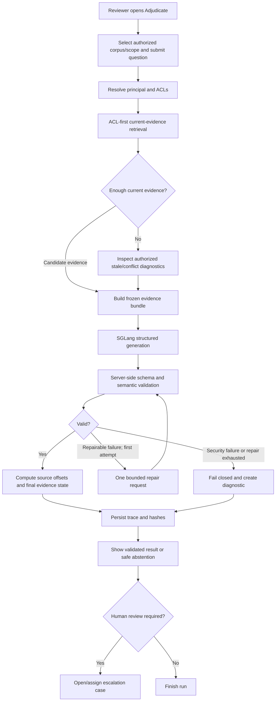
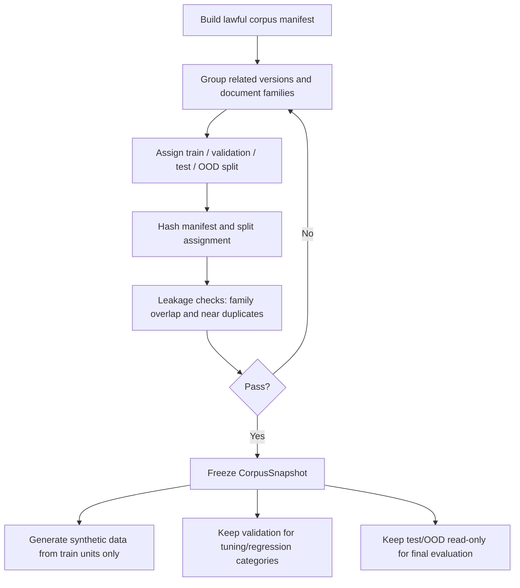
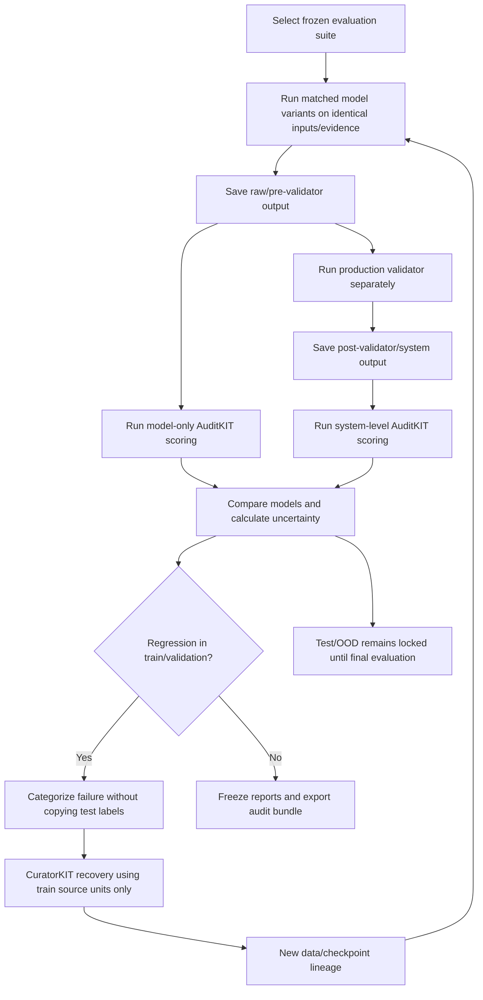

# ProofCite-Local — Product and ML Workflows

**Status:** Workflow specification derived from `IDEA.md` and `ARCHITECTURE.md`. Planned behaviour is not a claim that implementation/tests already exist. This document specifies navigation and functional behaviour; it intentionally does not prescribe visual styling or component-level UI details.

## 1. Operating modes and navigation

The workbench has two modes because the product serves two distinct jobs: evidence adjudication for a reviewer, and reproducible ML inspection for an engineer/judge.

### Reviewer mode

1. **Adjudicate** — ask a question over a permitted corpus/scope and inspect the final evidence state, validated claim records, citations and diagnostic action.
2. **Documents** — import/list allowed documents and inspect version status, effective dates, authority, access roles and source provenance.
3. **Version History** — examine version/supersession timelines and known precedence rules to understand whether sources can be treated as current.
4. **Evidence Runs** — revisit completed or failed question runs with their frozen retrieval evidence and final adjudication.
5. **Escalations** — review cases requiring a knowledge owner or human authority; document decisions and rationale.
6. **Source Inspector** — contextual screen opened from a citation or diagnostic; resolve a verified quote to its exact canonical span and original document location.
7. **Evidence Run Detail** — contextual screen with a run's trace, triaged chunks, validation outcome, repair attempts and final state.

### ML Auditor mode

1. **Overview** — current pipeline status, runtime readiness, last completed stage and artifact completeness.
2. **Corpus & Splits** — source inventory, licenses, document hashes, corpus snapshot, train/validation/test/OOD membership and leakage checks.
3. **Curation Runs** — CuratorKIT task execution, quality gates, rejected samples, adaptive recovery, exports and provenance.
4. **Training Runs** — resource profile, DA-RAFT, DPO and Dr. GRPO stage state, logs, checkpoints and adapter lineage.
5. **Model Arena** — base/raw-SFT/curated-SFT/final-adapter comparisons with identical questions and frozen evidence.
6. **Evaluations** — AuditKIT results, model-only versus system-gate scores, custom metrics, significance tests and runtime performance.
7. **Feedback & Recovery** — training/validation-only failure taxonomy and targeted CuratorKIT repair jobs.
8. **Lineage & Artifacts** — verifiable links between source snapshot, dataset, checkpoints/adapters, inference runs, evaluations and checksums.
9. **Runtime Diagnostics** — SGLang endpoint readiness, loaded models/adapters, schema smoke tests and benchmark records.

Raw model output, debug traces, private corpus text and training internals are auditor-only and must still be filtered by role and document ACL. A UI mode is not itself a security control.

## 2. Primary reviewer journey: ask a question

### Detailed step contract

1. The reviewer submits a question and a document/corpus scope. The server derives the principal from the active session; the client does not choose its own role or trusted tenant ID.
2. The service rejects inaccessible scopes before retrieval.
3. Retrieval first searches permitted active evidence. A separate permitted stale-candidate check may contribute to a `STALE` diagnostic but must not return stale text as current support.
4. Candidate evidence is frozen for the run. Every retrieved chunk has stable IDs, version, hash, ACL and triage metadata. The exact bundle is reused for any model comparison.
5. The prompt marks retrieved content as untrusted data. The generation model has no callable tools.
6. SGLang applies the generation-time JSON schema through XGrammar where supported. Application-level validation is still mandatory.
7. The server validates the envelope, resolves the unique exact quote in the specified source chunk/version, computes offsets and verifies source authority, version freshness, access permission, numeric values/units and claim-to-quote entailment.
8. The final `evidence_state` is server-derived from validated evidence; it is not accepted solely because the model emitted that enum.
9. If a safe semantic/quote repair is possible, the system makes at most one repair attempt using structured failure reasons. It does not retry authorization/security violations.
10. The UI only renders validated claims. It constructs the visible summary from validated claim records and diagnostics, not directly from unchecked model prose.
11. Every path records a run trace, including failed and abstained runs, so reliability metrics do not silently exclude failures.
12. Conflicts, missing premises, stale-only evidence or exhausted validation failures can create a human escalation case.

## 3. Evidence-state workflow

| State | Trigger | Claims shown | Diagnostics | Human review |
|---|---|---|---|---|
| `SUPPORTED` | All required premises are established by active, authorized sources and all claim checks pass. | Only validated supported claims. | Source/version/quote per claim. | Not mandatory by state, though the business process may require approval. |
| `PARTIAL` | Some required premises are supported; at least one remains missing. | Only validated supported portions. | Explicit `missing_information[]` and rejected distractors as appropriate. | Required when the missing premise blocks a consequential decision. |
| `MISSING` | No sufficient source-backed answer is available. | No substantive factual answer claims. | Missing premise(s), retrieval coverage and safe next step. | Route to knowledge owner when a policy/source is expected to exist. |
| `CONFLICTED` | Active authorized sources disagree and no precedence rule settles the issue. | Do not synthesize the disagreement into one answer. | Both exact source spans, version IDs and conflict reason. | Required; do not auto-resolve. |
| `STALE` | Only source match is expired or superseded and no active source answers the question. | No stale text represented as current authority. | Stale version and effective/superseded metadata, when user is authorized to see it. | Route to owner for an active source or authoritative decision. |

The state resolver must have explicit transition rules and tests. For example, an answer must not remain `SUPPORTED` after one required claim fails entailment or authorization validation.

## 4. Document ingestion and versioning workflow

```mermaid
flowchart LR
  A[Upload/import file] --> B[Verify file type, size and source permissions]
  B --> C[Hash source and create immutable record]
  C --> D[Extract text and structure]
  D --> E[Canonicalize text and construct source map]
  E --> F[Split into chunks while retaining ranges]
  F --> G[Attach ACL, authority, version and effective dates]
  G --> H[Build/update sparse and optional dense indexes]
  H --> I[Run ingestion integrity and leakage checks]
  I --> J[Register document version and provenance]
```

### Binding requirements

- Replacing a document creates a new immutable `DocumentVersion`; do not overwrite the prior version's source text or hash.
- Store who uploaded/imported it, when it was approved, source hash, parsing/canonicalization version and any licence/usage conditions.
- Preserve canonical character ranges and source maps. If a PDF is being used, store page/location mapping where the parser provides it; source highlighting must use server-computed offsets.
- Assign ACL metadata before indexing. The retrieval layer must filter on permissions before top-k selection and independently re-authorize any cited source after generation.
- Record `effective_from`, `effective_until`, status and supersession relation. If a conflict cannot be resolved by a defined authority/precedence rule, keep both sources and trigger `CONFLICTED`.
- When document/version metadata or ACLs change, invalidate/rebuild affected indexes and any cached evidence bundles that could expose stale permissions or content.
- Only approved lawful source data may enter the training corpus. Do not ingest restricted, confidential or personal data without the required authorization and rights.

## 5. Dataset split-lock workflow

The original plan names 550 in-domain split units: 500 CUAD contracts, 26 SEC 10-K filings and 24 policy/runbook families, split into 440 train / 55 validation / 55 test units, plus 30 held-out OOD documents.

The 550/30 counts are the intended plan, not an already-created dataset. Before any synthesis, the implementation must calculate actual counts, identify missing/licensing issues, save the split manifest and hashes, and assert the exact test/OOD inputs are excluded from training/repair. If source availability requires changing counts, record a new experiment manifest rather than silently proceeding with different counts.

## 6. CuratorKIT workflow

1. Verify the environment and required CuratorKIT version/installation; record licence notices and package versions.
2. Read the frozen corpus manifest and select train-only source units.
3. Run raw, ungated generation as a baseline with the same example/token budget as the curated experiment.
4. Run separate curated jobs for the required task variants (for example `qa`, `cot`, `adversarial_qa`, `adversarial_preference`, and `grpo`); a single task setting does not imply all tasks executed.
5. Configure the independent cross-family judge endpoint explicitly. Do not use the same model weights as both generator and judge for the planned cross-family-gating experiment.
6. Configure provenance-grounding, reward/diversity gates, intended embedding deduplication and hygiene checks explicitly; do not rely on undocumented defaults.
7. Route rejected samples to adaptive recovery by a structured failure taxonomy. Recovered examples must pass the gates again; unrecoverable cases remain in `rejected.jsonl` with their reasons.
8. Export train-ready files, provenance records, manifests, dataset card, rejection/diagnostic summaries and SHA-256 checksums.
9. Validate source-quote containment, source lineage, split membership and the configured token/example budget before marking the dataset ready for training.

## 7. AlignTune progressive training workflow

Training is gated. Each stage can be skipped only if the checkpoint already exists, its manifest and hash are verified, and the run configuration matches the intended experiment.

| Stage | Objective | Inputs | Outputs | Gate to continue |
|---|---|---|---|---|
| Preflight | Estimate hardware/time/memory and validate configuration. | Model, dataset size, algorithm, actual runtime. | Resource report, resolved config, environment manifest. | `aligntune advise`/config validation succeed; a smoke test fits in the actual runtime. |
| Baseline raw SFT | Establish ungated synthetic-data baseline. | Token/example-budget-matched raw data. | `sft_raw` checkpoint/adapter, logs and hash. | Adapter loads and a basic fixed-evidence test passes. |
| Curated SFT | Isolate effect of curation gates/recovery as a package. | CuratorKIT gated/recovered train export. | `curated_sft` checkpoint/adapter, lineage. | Dataset provenance and budget checks pass. |
| M1 — DA-RAFT | Teach distractor rejection and five-state answerability behaviour. | RAFT-style answerable examples with golden evidence plus distractors; unanswerable/conflict/stale distractor-only examples. | `stage2a_raft_sft` checkpoint/adapter. | No train/val/test leakage; state/claim schema tests pass. |
| M2 — DPO | Add adversarial preference alignment against decorative citations, distractor conflation and baseless answers. | Curated DPO preference pairs. | `stage2b_dpo` checkpoint/adapter. | Preference pairs have traceable source/provenance and valid labels. |
| M3 — Dr. GRPO | Test a bounded verifiable reward for exact-span grounding and calibrated abstention. | Controlled rollouts and `ProofCiteVerifiableReward`. | `stage2c_verifiable_grpo` checkpoint/adapter. | Reward-range, reward-hacking, false-abstention and validation tests pass. |
| Promotion | Register the candidate for serving. | Verified checkpoint and config hashes. | Versioned adapter registry entry. | Model loads under SGLang smoke tests and lineage is complete. |

### Training constraints

- Do not start SFT/RAFT/DPO/GRPO before profiling the exact model, dataset and GPU runtime.
- Resume from a verified checkpoint instead of retraining because a notebook disconnected.
- Save to persistent storage at stage boundaries and at suitable training intervals; notebook-local storage is temporary.
- Record actual GPU model, driver, CUDA/Python/package versions, seed, max sequence length, batch/gradient accumulation, optimizer, training duration, peak memory, tokens processed and failed steps.
- Do not run a separate generator, independent judge, fine-tuning process and four-adapter serving instance concurrently unless the measured hardware budget supports it.
- If an experiment cannot fit the free resource budget, mark it blocked/incomplete. Do not report an unrun objective as an achieved result.

## 8. Evaluation workflow and closed-loop recovery

### Required separation

- **Model-only path:** raw SGLang generation before deterministic application validation. Use this to assess if curation/post-training improved the generator.
- **System path:** final output after deterministic validation and the one repair attempt, if used. Use this to assess whole-product reliability.
- Report the seven planned AuditKIT deterministic checks separately: `citation_support`, `abstention`, `numeric_accuracy`, `freshness`, `acl_compliance`, `evidence_set_recall`, `context_retention`.
- Also report the planned custom metrics: unsupported-claim rate, citation entailment precision, five-state macro F1, effective reliability and false-abstention rate.
- Freeze the evidence bundle across baselines. If retrieval changes between models, the experiment no longer isolates the model/training effect.
- Record dataset/model/config hashes, resampling unit, seed, sample counts, unscored cases, effect sizes, confidence intervals and p-values. Check the installed AuditKIT's actual bootstrap-clustering semantics rather than assuming its unit of resampling matches the plan.
- Only train/validation regression categories may guide adaptive repair. The locked test/OOD corpus stays read-only; don't pass its question/answer pairs, labels or failure categories into CuratorKIT.
- A successful regression loop means the new run is evaluated again; it does not mean the regression is resolved until observed results confirm it.

## 9. Model Arena workflow

Purpose: demonstrate training effects without changing retrieval or wrapping away model weakness.

1. Select a benchmark case and freeze its question, corpus snapshot and evidence bundle.
2. Dispatch the same input to each available variant: base + prompt/schema baseline, raw synthetic SFT, curated SFT, and final DA-RAFT/DPO/Dr. GRPO adapter. Use the correct registered SGLang adapter reference; do not assume the request `model` field hot-swaps model weights.
3. Save each raw output before the application validator. Do not alter the prompt/evidence between variants.
4. Run deterministic and entailment checks on the raw results and display model-only scores.
5. Run the production validator as a separate path; display post-validator outcomes independently.
6. Include answerable, missing, conflicted, stale/ACL, distractor and indirect prompt-injection cases, not only a favourable sample.
7. Measure startup/cold latency, steady-state latency, TTFT, throughput, peak VRAM, cache behaviour and failure rate. TTFT targets are not considered passed until measured on the stated environment.
8. Export the comparison and lineage package. A precomputed replay is acceptable as a fallback for demo reliability only when clearly labelled as recorded output, not a live model run.

## 10. Escalation workflow

1. An adjudication run sets `human_review_required=true` or the reviewer explicitly requests review.
2. Create a case with run ID, final evidence state, reason, exact permitted evidence references, missing premises/conflict pairs/stale metadata and a case status.
3. Assign it to an authorized knowledge owner or human reviewer.
4. The human may provide a decision, identify the authoritative source, request an updated document, or mark the issue unresolved. The system records actor, timestamp, note and source links.
5. The decision is not silently converted into model-verified truth. If the authoritative corpus is updated, create a new document version, update index/snapshot as permitted, and run a fresh adjudication.
6. The old run remains immutable for auditability; a new run links to it if it was triggered by the escalation resolution.

## 11. Runtime startup and readiness

1. Load configuration and validate the chosen profile (`demo`, `reviewer`, `training`, or `evaluation`).
2. Load the corpus snapshot/index metadata; verify its manifest and hash chain.
3. Verify model and adapter paths before starting serving.
4. Call configured SGLang readiness endpoints; test one structured-output request against the generation schema.
5. If using multi-LoRA, verify adapters are registered under stable names and test per-row/per-request adapter selection. Do not report four-model comparison readiness based only on successful server startup.
6. Run a small safe citation-validation test, an ACL-denial test and a no-evidence abstention test.
7. Mark readiness `READY` only if all profile-required checks pass. Distinguish `DEGRADED` (optional dense retrieval or optional adapter unavailable) from `BLOCKED` (SGLang unavailable, schema incompatibility, ACL bypass, lineage mismatch or validator failure).
8. Bind the workbench to loopback by default. Never expose private documents through an unauthenticated notebook tunnel.

## 12. Error and recovery matrix

| Failure | Required behaviour | May retry? |
|---|---|---|
| User lacks document permission | Deny request without revealing restricted content or metadata. | No model retry. |
| No active evidence | `MISSING`, or `STALE` when authorized stale support is the only candidate. | No generation retry unless the retrieval bug is corrected and a new run starts. |
| Active source conflict | `CONFLICTED`, show both permitted sources, require human review. | No automatic source selection. |
| Invalid schema/transport truncation | Record generation failure; retry only under explicit, bounded transport rules; no silent fallback model/API. | Transport retry policy is separate from the single semantic repair. |
| Quote not found/ambiguous | Reject citation, issue the one bounded repair only if safe; otherwise abstain. | At most one semantic repair. |
| Numeric/unit mismatch | Reject claim and record exact mismatch. | At most one safe repair. |
| ACL/version/hash invariant fails | Fail closed and record a security/integrity event. | Never repair by asking the model. |
| CuratorKIT gate rejects sample | Preserve rejection reason; attempt configured adaptive recovery. | Only within configured retry/recovery budget. |
| Training runs out of free compute | Save last valid checkpoint/logs; mark stage incomplete/paused. | Resume only after integrity and configuration checks. |
| Audit regression | Preserve report and classify regression on train/validation only. | May start a new recovery/training experiment, never overwrite old evidence. |

## 13. Test scenarios required before calling the workflow complete

- A straightforward answerable question produces verified claims and exact source links.
- The retrieved bundle contains a near-miss distractor from an inapplicable contract/policy; it is triaged and not cited.
- One required premise is absent; the result is `PARTIAL` or `MISSING` according to whether any meaningful premise is safely supportable.
- Two active policies conflict without precedence; the state is `CONFLICTED` and both active exact spans are preserved.
- A superseded policy contains the only apparent answer; the state is `STALE`, not `SUPPORTED`.
- A chunk contains an indirect prompt injection; it is treated as untrusted data and no tools are invoked.
- A citation names an unauthorized doc/chunk; retrieval and validation prevent it from reaching the reviewer as verified evidence.
- A quote occurs twice in canonical text; the resolver refuses to choose an arbitrary occurrence.
- Whitespace/Unicode canonicalization changes positions; the source-map resolver still points to the matching original range, or fails closed when it cannot prove the mapping.
- A number or unit differs between claim and source; the claim fails validation.
- The first repair remains invalid; the system abstains and creates a diagnostic record without a second semantic repair.
- An ACL is revoked after a prior query; a new request and any opened source link re-check permissions and do not reuse an unsafe cached result.
- A validation regression originates in the locked test set; it is recorded but never passed into recovery.
- A missing artifact/hash causes the lineage check to fail rather than report a complete run.

## 14. Five-scene demonstration sequence

This is a demo flow, not a promise of expected model accuracy. Use real captured outputs from the implementation and include any failures.

1. **Baseline failure:** show base/prompt-only behaviour on one hard near-miss distractor case with frozen evidence.
2. **Citation adjudication:** select a claim and prove it resolves to the exact authorized source range; demonstrate that the server, not the model, computed offsets.
3. **Abstention/conflict:** ask a missing-premise or active-conflict question and show the diagnostic and human escalation path.
4. **Model Arena:** run matched base/raw/curated/final variants and show raw model-only outputs and scores separately from the system-validator outputs.
5. **Closed-loop audit:** show a measured training/validation regression category, its CuratorKIT repair artifact, lineage, and follow-up evaluation. If the loop has not actually run, show the workflow as planned or replay saved real artifacts with clear labelling.

## 15. Completion definition

The workflow is ready for judging only when the supported path is demonstrably end-to-end: authorized corpus → frozen evidence → SGLang structured generation → deterministic span/ACL/freshness/numeric/entailment checks → five-state result → saved audit trace → AuditKIT report. Training-stage milestones are reported independently and must be labelled incomplete when they have not run. No planned result, expected output, or score forecast is presented as measured evidence.
